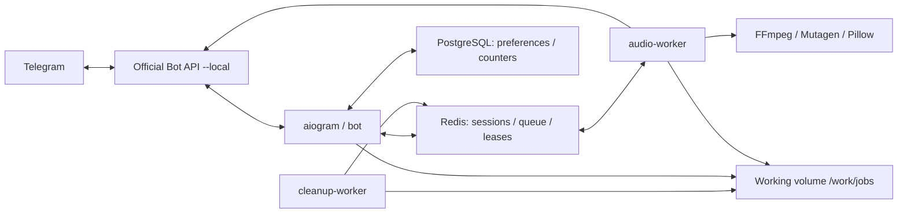

# Архитектура

## Модули

- `bot.py`, `keyboards.py`, `states.py`: приватные чаты, FSM, меню, валидация ввода.
- `models.py`: схема сессии и отложенных правок.
- `store.py`: временные Redis-сессии и атомарное помещение задачи в очередь.
- `workers.py`: анализ, обработка, доставка и фиксация счётчиков.
- `services/probe.py`: FFprobe, определение реального контейнера/кодека.
- `services/converter.py`: выбор копирования / remux / кодирования и перенос тегов.
- `services/metadata.py`: ID3, MP4, FLAC, Vorbis tags/pictures.
- `services/audio.py`, `services/merge.py`: фильтры, временные интервалы, объединение.
- `services/covers.py`, `services/files.py`: изображения, пути, квоты, очистка.
- `cleanup.py`: неактивные сессии и аварийные остатки.
- `database.py`, `migrations/`: SQL-миграции, настройки, агрегаты без содержимого файлов.

## Задачи и очередь

Состояния: receiving → queued → analyzing → editing → queued → processing → sending → удаление.
В пакетном режиме processing/sending повторяются для каждого файла.
`Redis BLMOVE` переносит элемент из `queue` в `processing`; сессия и постановка в очередь
записываются транзакцией. Обработчик захватывает lease с ограниченным временем жизни.
Обработчики UI сериализованы aiogram RedisEventIsolation, при редактировании также
берут lease, чтобы cleanup не удалил файл одновременно с правкой.

Если lease занят, элемент возвращается в очередь: нажатие «Подтвердить» не теряет
задачу, даже когда UI ещё заканчивает обработку callback. Повторное нажатие проверяет
статус сессии и не ставит уже обрабатываемую задачу второй раз.
В Redis нет AOF/RDB. После перезапуска Redis незавершённые сессии теряются, но файловая
аварийная очистка остаётся. После сбоя worker автоматической повторной отправки нет.

## Изоляция и ресурсы

Случайный 128-битный идентификатор каталога; имена пользователя используются только
как безопасное имя отправляемого файла. Внутренние имена `source`, `result_N.ext` фиксированы.
getFile разрешается только внутри отдельного read-only volume `/telegram`.
Очистка умеет удалять только прямые UUID-каталоги внутри `JOBS_DIR`; symlink запрещён.

FFmpeg запускается аргументами `create_subprocess_exec`, без shell. Разрешены только
локальный протокол `file` и аудиодемультиплексоры. Worker не имеет маршрута в интернет;
контейнер работает с UID 10001, read-only rootfs, без capabilities, с лимитами RAM/CPU/PID.
FFmpeg ограничен одним потоком и временем операции; контроль диска работает во время обработки.
Неактивный worker/cleanup перезапускается Docker при завершении процесса; unhealthy
сам по себе не вызывает restart, поэтому внешний мониторинг должен проверять health status.

## Приватность диагностики

Сохраняются только job UUID и класс ошибки. Нет исходных имён, тегов, аудио, текста
исключений сторонних библиотек или токенов в прикладных логах. Админ получает агрегаты,
не рабочие пути или вложения. PostgreSQL не содержит историю файлов и сессий.
